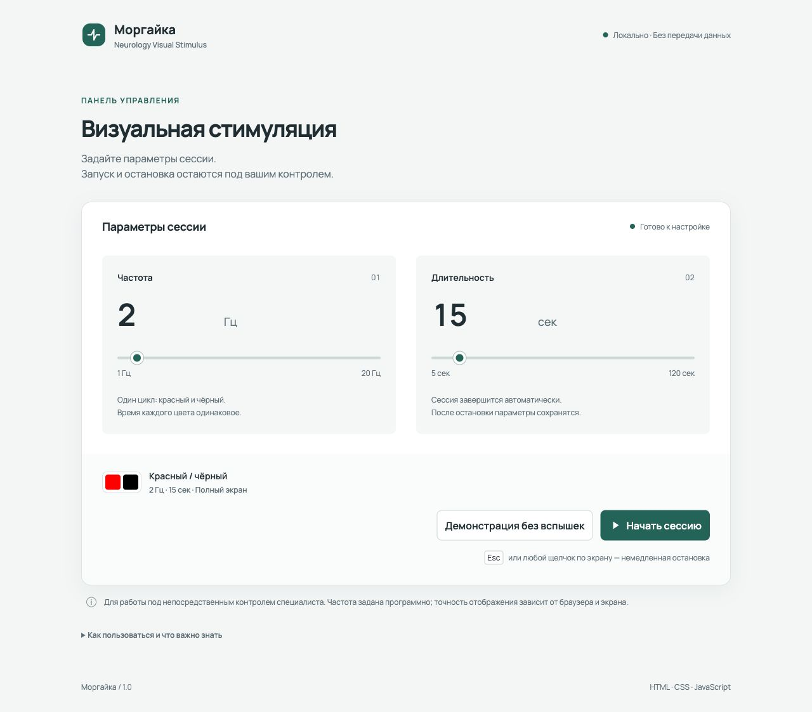
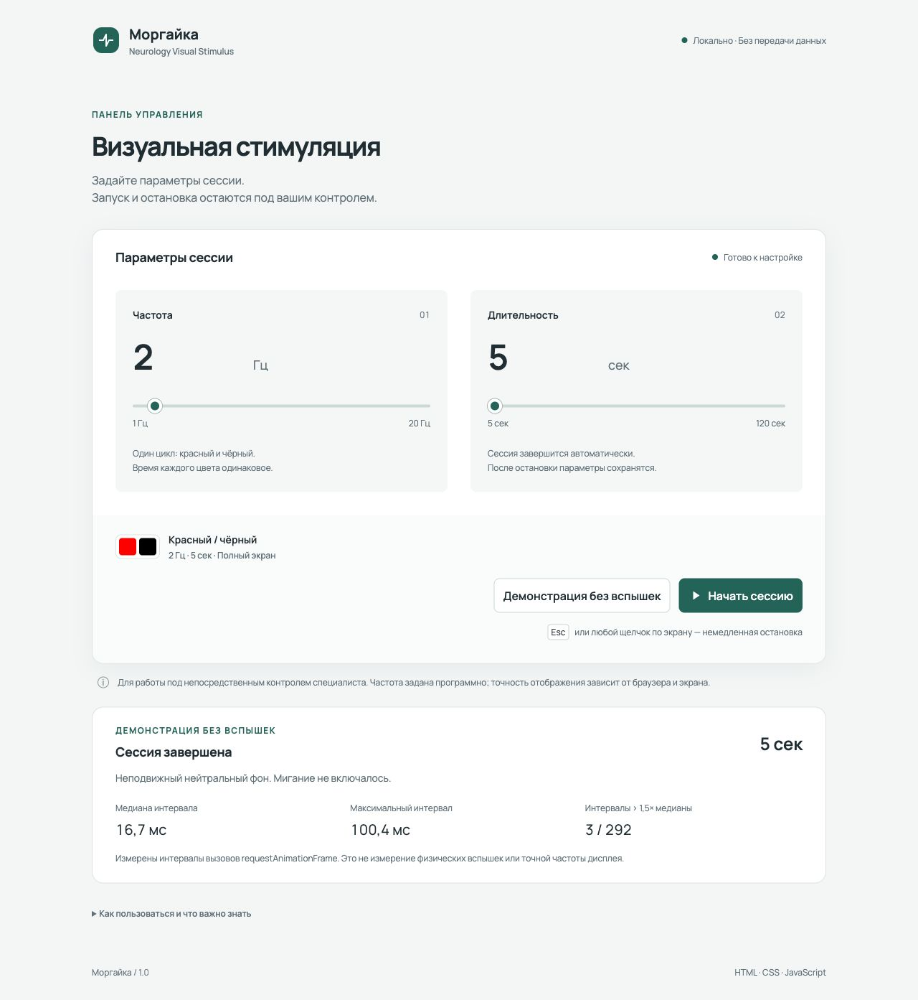

# Моргайка

**Neurology Visual Stimulus** — локальное браузерное приложение с настройкой частоты и продолжительности полноэкранного чередования красного и чёрного.

Это новая реализация идеи ранее созданной владельцем программы на C# для Windows. Исходный код прежней версии утрачен; браузерная версия написана с нуля с помощью Codex. Преемственность относится к идее, а не к исходникам или подтверждённой эквивалентности поведения.

Проект предназначен для портфолио. Исходный сценарий — управление визуальной стимуляцией неврологом под его непосредственным наблюдением. Конкретное клиническое назначение не заявляется. Медицинская точность, пригодность для обследований и клиническая сертификация не подтверждены.



## Возможности

- Частота от 1 до 20 Гц, шаг 0,5 Гц. По умолчанию — 2 Гц.
- Один герц означает один полный цикл «красный + чёрный». Доля времени каждого цвета — 50% в заданной временной модели.
- Длительность от 5 до 120 секунд, шаг 5 секунд. По умолчанию — 15 секунд.
- Числовой ввод и ползунки с общей проверкой параметров.
- Стимуляция только после нажатия кнопки и подтверждённого входа в полный экран.
- Остановка по Esc, щелчку по полю, потере фокуса, скрытию вкладки, выходу из полного экрана и истечению времени.
- Возврат к настройкам без автоматического возобновления.
- Демонстрация с неподвижным нейтральным фоном без вспышек.
- После сессии: причина завершения, прошедшее время, статистика интервалов кадров.
- Адаптивная вёрстка, клавиатурная навигация и видимый фокус.

Диапазоны являются настройками программного прототипа, а не медицинскими рекомендациями.

## Запуск на Windows

1. Скачайте проект и распакуйте архив целиком.
2. Откройте `index.html` через «Открыть с помощью» → Microsoft Edge или Google Chrome.
3. Сначала выберите **«Демонстрация без вспышек»**.
4. Чтобы остановить демонстрацию, нажмите Esc или щёлкните в любом месте поля.

Приложению не нужны Python, Node.js, установка пакетов, сборка, интернет или сервер. Файлы `assets`, `src` и `styles.css` должны оставаться рядом с `index.html` в исходной структуре.

Запуск из PowerShell, находясь в папке проекта:

```powershell
Start-Process .\index.html
```

Для явного выбора браузера используйте меню «Открыть с помощью». Если браузер запрещает Fullscreen API для локальной страницы, приложение сообщит об ошибке и не начнёт стимуляцию. Не отключайте защиту браузера.

## Firefox на macOS

Откройте Firefox, нажмите `⌘O` и выберите `index.html`. Для первой проверки используйте демонстрацию. Для остановки — Esc или щелчок.

Firefox на macOS и Edge/Chrome на Windows являются целевыми средами. Их ручная проверка на реальных системах ещё предстоит; они не обозначаются как протестированные. Текущее состояние проверок указано в [журнале](docs/verification.md).

## Демонстрация без вспышек

Кнопка демонстрации запускает тот же контроллер сессии и обработчики остановки, но на экране остаётся неподвижный фон `#272727`. Заданная частота не меняет фон демонстрации. Элементов интерфейса поверх поля нет.

Для показа проекта с отключённой кнопкой реальной стимуляции добавьте к адресу страницы `?demo=1`, например:

```text
file:///C:/Projects/morgayka/index.html?demo=1
```

Путь замените на фактический. Это режим демонстрации, не граница безопасности: обычный адрес по-прежнему позволяет запускать стимуляцию. При каждом открытии страницы мигания нет.



## Как устроено управление временем

Цвет вычисляется из прошедшего времени:

```text
halfCycleIndex = floor(elapsedMilliseconds × frequencyHz × 2 / 1000)
чётный индекс → чёрный; нечётный → красный
```

Сессия начинается с чёрного. `requestAnimationFrame` вызывает обновление перед возможной перерисовкой. Расчёт использует абсолютное прошедшее время, поэтому задержки не накапливаются как при последовательном прибавлении интервалов. Пропущенные фазы не воспроизводятся ускоренно.

Конец сессии проверяется в каждом кадре; отдельный `setTimeout` дополнительно запрашивает завершение, если кадры не поступают. Оба механизма работают в том же потоке браузера: второй таймер не является независимым аппаратным ограничителем времени.

Остановка идемпотентна: отменяет кадры и таймер, убирает поле, запрашивает выход из полного экрана и восстанавливает управление. Поздний ответ на отменённый запрос полного экрана не возобновляет сессию. Повторный запрос блокируется, пока предыдущий не завершён.

## Ограничения браузерной реализации

- **Заданная частота не гарантирует физическую частоту вспышек.** Смена цвета привязана к доступным кадрам экрана и зависит от браузера, ОС, нагрузки, композитора и дисплея.
- Например, при 60 кадрах/с и 20 Гц на половину цикла приходится 1,5 кадра. Постоянную длительность каждой половины на такой кадровой сетке воспроизвести невозможно. На других частотах обновления соотношение меняется.
- В отчёте измеряются интервалы между вызовами `requestAnimationFrame`, а не физическое изменение света. Медиана интервала не называется измеренной частотой монитора. Максимум и число интервалов больше 1,5 медианы — диагностические показатели, не медицинские метрики.
- Браузер может пропустить перерисовку после callback. Получить надёжное подтверждение каждого физически показанного кадра этим API нельзя.
- Обработка Esc, мыши, таймеров и событий фокуса зависит от доступности основного потока. При зависании браузера или ОС абсолютная мгновенность остановки и жёсткий предел длительности не гарантируются.
- При потере фокуса, скрытии вкладки или выходе из fullscreen сессия завершается при обработке соответствующего события. Самостоятельного продолжения нет.
- Полный экран требует пользовательского действия и может быть запрещён. Браузер может показать собственное уведомление; приложение его не скрывает и не перехватывает системный выход по Esc.
- Чистые RGB `#FF0000` и `#000000` не гарантируют одинаковую яркость и спектр на разных дисплеях. Калибровка не выполнялась.
- Настройки живут в памяти страницы. Перезагрузка восстанавливает начальные значения. Данные пациентов, история сессий и пользовательские данные не сохраняются и не отправляются.

Если понадобится подтверждённая физическая точность, потребуется отдельная проверка оборудования и измерение светового сигнала. Сама замена JavaScript на нативное приложение такой точности не доказывает.

Справочные материалы: [requestAnimationFrame](https://developer.mozilla.org/en-US/docs/Web/API/Window/requestAnimationFrame), [Fullscreen API](https://developer.mozilla.org/en-US/docs/Web/API/Fullscreen_API), [requestFullscreen](https://developer.mozilla.org/en-US/docs/Web/API/Element/requestFullscreen).

## Структура

```text
index.html                семантический интерфейс
styles.css                оформление и адаптивная вёрстка
src/core.js               проверка параметров, временная модель, сессия
src/app.js                DOM, браузерные API, события и результаты
assets/favicon.svg        значок приложения
assets/fonts/             локальный Manrope и его лицензия
tests/                   тесты расчётов и интеграции через DOM-адаптер
docs/verification.md     фактические проверки и ручной сценарий
docs/screenshots/        настоящие скриншоты без анимации
```

HTML и обычные скрипты намеренно используются без ES modules и `fetch`: приложению не нужен локальный сервер для загрузки собственного кода. Серверные компоненты и сторонние JS-библиотеки отсутствуют.

## Тесты для разработчика

Нужен Node.js 20 или новее. Установка зависимостей не требуется. В папке проекта выполните:

```sh
node --test
```

Или, если установлен npm:

```sh
npm test
```

Тесты проверяют границы фаз, валидацию, задержки кадров, дедлайн, повторную остановку, отмену ожидающего запуска, отказ fullscreen и подключение обработчиков браузерных событий. Интеграционные тесты используют небольшой DOM-адаптер: это не эмуляция движка браузера и не замена ручной проверке. Реальные вспышки тесты не включают.

Результат текущего прогона: **25 тестов, 25 пройдено**. Подробности и границы покрытия — в [журнале проверок](docs/verification.md).

## Что проект демонстрирует

Работу с браузерными API, явными состояниями и асинхронными гонками, расчётом анимации по времени, обработкой ошибок, доступными элементами управления и тестируемой логикой без зависимостей.

После самостоятельного разбора кода описание для резюме можно сформулировать так:

> Браузерный прототип визуальной стимуляции на HTML, CSS и JavaScript: Fullscreen API, управление фазами через requestAnimationFrame, обработка прерываний и демонстрация без вспышек. Разработка с помощью ИИ, модульные и интеграционные тесты.

Вопросы для подготовки к собеседованию:

1. Почему частота стимуляции отличается от частоты кадров и почему важны половины цикла?
2. Почему `setInterval` не используется для накопления фаз?
3. Что произойдёт, если пользователь отменит запуск до разрешения fullscreen?
4. Почему статистика rAF не доказывает физическую точность?
5. Что проверяет DOM-адаптер и какие проблемы он не может обнаружить?

## За пределами MVP

Нет клинических протоколов, калибровки, хранения данных пациентов, экспорта истории, удалённого управления и подбора параметров обследования. Нет заявлений об испытаниях на пациентах.

## Сторонние материалы и права

Manrope поставляется локально из [Google Fonts](https://github.com/google/fonts/tree/main/ofl/manrope) с лицензией SIL Open Font License 1.1; текст находится в `assets/fonts/OFL.txt`. Знак приложения выполнен в SVG внутри проекта.

Лицензия на исходный код приложения пока не выбрана. Лицензия шрифта не распространяется автоматически на код. Выбор лицензии требует отдельного решения владельца.
